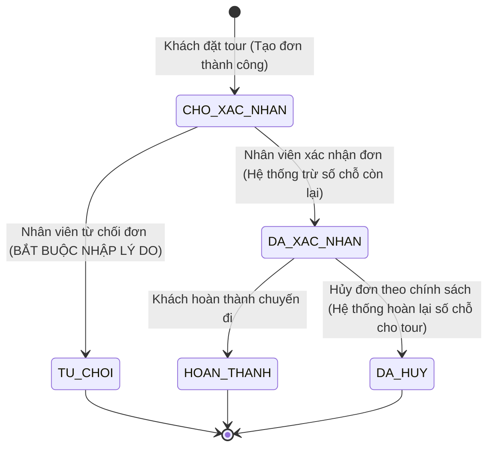

# TÀI LIỆU PHÂN TÍCH NGHIỆP VỤ & ĐẶC TẢ USE CASE HỆ THỐNG DU LỊCH (TRAVELWEB)
**Mã công việc:** DL-03 (Sprint 1 / Tuần 1)  
**Thành viên phụ trách:** Bùi Trung Kiên (Phân tích nghiệp vụ & Backend quản lý)  
**Phối hợp:** Khải (Điều phối & Rà soát bài toán)  
**Tiêu chí nghiệm thu:** Actor và quyền đúng với tài liệu; bao gồm xem địa điểm, tài khoản, quản lý tour/đơn và quản trị.

---

## 1. DANH SÁCH ACTOR & BẢNG PHÂN QUYỀN TRUY CẬP

| Actor | Tên Tiếng Việt | Mô Tả Vai Trò & Quyền Hạn |
| :--- | :--- | :--- |
| **Guest** | Khách vãng lai | Người dùng truy cập website chưa đăng nhập. Có quyền xem danh sách và chi tiết địa điểm du lịch, xem danh sách tour, lịch trình, khuyến mãi; tra cứu đơn qua Mã tra cứu công khai; gửi yêu cầu liên hệ hỗ trợ; đăng ký tài khoản. |
| **Customer** | Khách hàng | Người dùng đã đăng nhập hoặc đã đặt dịch vụ. Có quyền đặt tour, thanh toán tiền cọc, xem lịch sử các đơn đặt tour của chính mình, gửi đánh giá nhận xét và chấm điểm sao sau chuyến đi, yêu cầu hủy đơn. |
| **Staff / Manager** | Nhân viên / Quản lý (Kiên) | Nhân viên vận hành hệ thống. Có quyền tiếp nhận và xử lý đơn đặt tour (Xác nhận, Từ chối kèm lý do bắt buộc, cập nhật trạng thái); Quản trị tour, lịch trình, khuyến mãi, số chỗ còn lại (chống âm); Quản trị địa điểm và hình ảnh; Kiểm duyệt đánh giá; Tiếp nhận và xử lý liên hệ; Quản lý nhà cung cấp đối tác. |
| **Administrator** | Quản trị viên hệ thống (Admin) | Toàn quyền kiểm soát hệ thống: Tất cả quyền của Nhân viên + Quản lý tài khoản, phân quyền vai trò (Role), khóa/mở khóa tài khoản, xem dashboard báo cáo doanh thu tài chính. |

---

## 2. SƠ ĐỒ USE CASE TỔNG THỂ HỆ THỐNG (SYSTEM USE CASE DIAGRAM)

```mermaid
flowchart TB
    subgraph Actors["CÁC TÁC NHÂN (ACTORS)"]
        Guest["Khách Vãng Lai (Guest)"]
        Customer["Khách Hàng (Customer)"]
        Staff["Nhân Viên (Staff / Manager)"]
        Admin["Quản Trị Viên (Admin)"]
    end

    subgraph GuestUseCases["PHÂN HỆ KHÁCH HÀNG & CÔNG KHAI"]
        UC01(["UC-01: Xem & Tìm kiếm địa điểm"])
        UC02(["UC-02: Xem chi tiết tour & Lịch trình"])
        UC03(["UC-03: Tra cứu đơn qua Mã tra cứu"])
        UC04(["UC-04: Gửi tin nhắn liên hệ hỗ trợ"])
        UC05(["UC-05: Đăng ký & Đăng nhập"])
        UC06(["UC-06: Đặt tour du lịch"])
        UC07(["UC-07: Thanh toán tiền cọc"])
        UC08(["UC-08: Xem lịch sử đơn đặt tour"])
        UC09(["UC-09: Gửi đánh giá & Chấm sao"])
    end

    subgraph StaffUseCases["PHÂN HỆ QUẢN TRỊ & VẬN HÀNH (KIÊN PHỤ TRÁCH)"]
        UC10(["UC-10: Quản lý địa điểm & Ảnh (DL-09)"])
        UC11(["UC-11: Quản lý tour, lịch trình, số chỗ (DL-13)"])
        UC12(["UC-12: Xử lý đơn đặt: Xác nhận / Từ chối (DL-19)"])
        UC13(["UC-13: Kiểm duyệt đánh giá khách (DL-22)"])
        UC14(["UC-14: Xử lý & Phản hồi liên hệ (DL-22)"])
        UC15(["UC-15: Quản lý Nhà cung cấp đối tác (DL-22)"])
    end

    subgraph AdminUseCases["PHÂN HỆ QUẢN TRỊ CẤP CAO"]
        UC16(["UC-16: Quản lý tài khoản & Phân quyền"])
        UC17(["UC-17: Xem báo cáo doanh thu & Thống kê"])
    end

    Guest --> UC01
    Guest --> UC02
    Guest --> UC03
    Guest --> UC04
    Guest --> UC05

    Customer -- Kế thừa quyền --> Guest
    Customer --> UC06
    Customer --> UC07
    Customer --> UC08
    Customer --> UC09

    Staff --> UC10
    Staff --> UC11
    Staff --> UC12
    Staff --> UC13
    Staff --> UC14
    Staff --> UC15

    Admin -- Kế thừa quyền --> Staff
    Admin --> UC16
    Admin --> UC17
```

---

## 3. QUY TRÌNH CHUYỂN TRẠNG THÁI ĐƠN ĐẶT TOUR (STATE MACHINE - DL-19)

---

## 4. MA TRẬN PHÂN QUYỀN CHI TIẾT (PERMISSION MATRIX)

| Mã Use Case | Tên Chức Năng | Guest | Customer | Staff (Kiên) | Admin | Ghi Chú Nghiệp Vụ |
| :--- | :--- | :---: | :---: | :---: | :---: | :--- |
| **UC-01** | Xem & tìm kiếm địa điểm | ✔ | ✔ | ✔ | ✔ | Công khai |
| **UC-02** | Xem chi tiết tour & lịch trình | ✔ | ✔ | ✔ | ✔ | Công khai |
| **UC-03** | Tra cứu đơn bằng mã tra cứu | ✔ | ✔ | ✔ | ✔ | Công khai |
| **UC-04** | Gửi form liên hệ hỗ trợ | ✔ | ✔ | ✔ | ✔ | Khách gửi thắc mắc |
| **UC-05** | Đăng ký & Đăng nhập | ✔ | ✔ | ✔ | ✔ | Quản lý tài khoản |
| **UC-06** | Đặt tour du lịch | ❌ | ✔ | ✔ | ✔ | Cần nhập thông tin khách |
| **UC-07** | Đặt cọc / Thanh toán | ❌ | ✔ | ✔ | ✔ | Cọc từ 30% - 50% |
| **UC-08** | Xem lịch sử đơn đặt cá nhân | ❌ | ✔ | ✔ | ✔ | Khách chỉ xem đơn của mình |
| **UC-09** | Gửi đánh giá tour / địa điểm | ❌ | ✔ | ✔ | ✔ | Sau khi đã đặt hoặc đi tour |
| **UC-10** | Quản lý Địa điểm & Upload ảnh (DL-09) | ❌ | ❌ | ✔ | ✔ | Thêm, sửa, đổi trạng thái |
| **UC-11** | Quản lý Tour, Lịch trình, Số chỗ (DL-13) | ❌ | ❌ | ✔ | ✔ | Validate số chỗ >= 0 |
| **UC-12** | Xử lý Đơn: Duyệt / Từ chối (DL-19) | ❌ | ❌ | ✔ | ✔ | Lưu lý do từ chối, ghi nhận log |
| **UC-13** | Kiểm duyệt Đánh giá (DL-22) | ❌ | ❌ | ✔ | ✔ | Không sửa lời khách, duyệt/ẩn |
| **UC-14** | Xử lý Liên hệ khách hàng (DL-22) | ❌ | ❌ | ✔ | ✔ | Trả lời & cập nhật trạng thái |
| **UC-15** | Quản lý Nhà cung cấp (DL-22) | ❌ | ❌ | ✔ | ✔ | Đối tác khách sạn, xe, nhà hàng |
| **UC-16** | Quản trị tài khoản & Phân quyền | ❌ | ❌ | ❌ | ✔ | Quyền riêng của Admin |
| **UC-17** | Xem báo cáo tài chính, doanh thu | ❌ | ❌ | ❌ | ✔ | Phân hệ của Khang/Hiếu |

---

## 5. ĐẶC TẢ CHI TIẾT CÁC USE CASE DO KIÊN PHỤ TRÁCH

### Use Case 10: Quản Lý Địa Điểm & Hình Ảnh (Mã DL-09)
* **Actor:** Nhân viên / Admin.
* **Tiền điều kiện:** Người dùng đã đăng nhập với vai trò `NHAN_VIEN` hoặc `ADMIN`.
* **Hậu điều kiện:** Dữ liệu địa điểm được cập nhật trong CSDL; ảnh được lưu trữ an toàn trong `wwwroot/images`.
* **Luồng chính (Main Flow):**
  1. Nhân viên truy cập trang Quản lý địa điểm (`/AdminDiaDiem`).
  2. Hệ thống kiểm tra Session quyền truy cập hợp lệ và hiển thị danh sách địa điểm.
  3. Nhân viên chọn "Thêm Địa Điểm Mới" hoặc "Sửa" một địa điểm.
  4. Nhân viên nhập Tên địa điểm, chọn Danh mục, nhập Địa chỉ, Hotline, Văn hóa, Ẩm thực, Nơi cần tới.
  5. Nhân viên tải lên file ảnh mới (upload) hoặc chọn ảnh từ thư viện có sẵn.
  6. Nhân viên nhấn nút "Lưu Địa Điểm".
  7. Hệ thống kiểm tra ràng buộc (ModelState Validation):
     - Tên địa điểm không rỗng.
     - Danh mục hợp lệ.
     - Địa chỉ bắt buộc.
  8. Hệ thống lưu vào bảng `DIA_DIEM` và hiển thị thông báo thành công.
* **Luồng ngoại lệ (Exception Flow):**
  - Người dùng có vai trò `KHACH_HANG` truy cập URL trực tiếp -> Hệ thống chặn và chuyển hướng sang trang `KhongCoQuyen` (403).
  - Nhân viên xóa địa điểm đang có tour liên kết -> Hệ thống cảnh báo từ chối xóa cứng để bảo vệ toàn vẹn dữ liệu khóa ngoại, gợi ý chuyển trạng thái sang "Đóng cửa".

---

### Use Case 11: Quản Lý Tour, Lịch Trình, Số Chỗ Còn Lại & Khuyến Mãi (Mã DL-13)
* **Actor:** Nhân viên / Admin.
* **Tiền điều kiện:** Có quyền quản lý.
* **Hậu điều kiện:** Tour được lưu, số chỗ còn lại được kiểm soát chống âm, khuyến mãi được cập nhật.
* **Luồng chính (Main Flow):**
  1. Nhân viên truy cập Quản lý tour (`/AdminTour`).
  2. Chọn Thêm tour hoặc Sửa tour.
  3. Nhập Tên tour, Địa điểm liên kết, Giá gốc, Tỷ lệ cọc, Thời lượng tour.
  4. Nhập Số chỗ tối đa và **Số chỗ còn lại**.
  5. Nhập Giá khuyến mãi (nếu có chương trình ưu đãi).
  6. Soạn thảo Lịch trình chi tiết từng ngày (Ngày 1, Ngày 2, Ngày 3...).
  7. Chọn hình ảnh và nhấn "Lưu Tour".
  8. Hệ thống kiểm tra nghiệp vụ bắt buộc:
     - Số chỗ còn lại không được phép âm (`SoChoConLai >= 0`).
     - Số chỗ còn lại không được vượt quá số chỗ tối đa (`SoChoConLai <= SoChoToiDa`).
     - Giá khuyến mãi (nếu có) phải nhỏ hơn giá gốc (`GiaKhuyenMai < GiaTien`).
  9. Hệ thống lưu thành công và cập nhật trạng thái `HET_CHO` tự động nếu số chỗ còn lại = 0.
* **Chức năng 1-Click Toggle:**
  - Nút bấm ngừng bán tour / mở bán lại tour ngay trên danh sách mà không cần mở form sửa.

---

### Use Case 12: Màn Hình Nhân Viên Xử Lý Đơn Đặt Tour (Mã DL-19)
* **Actor:** Nhân viên tiếp nhận đơn.
* **Tiền điều kiện:** Đơn đặt tour ở trạng thái `CHO_XAC_NHAN`.
* **Luồng chính A - Xác nhận đơn (Confirm Booking):**
  1. Nhân viên mở chi tiết đơn đặt tour (`/AdminDonDat/Details/{id}`).
  2. Kiểm tra thông tin khách hàng, số lượng khách, số tiền cọc, ngày đi.
  3. Kiểm tra số chỗ còn lại của Tour tương ứng.
  4. Nhân viên nhấn nút **"XÁC NHẬN ĐƠN NÀY"**.
  5. Hệ thống:
     - Kiểm tra nếu tour còn đủ chỗ -> Tự động trừ số chỗ còn lại của tour (`tour.SoChoConLai -= don.SoLuongKhach`).
     - Chuyển `TrangThaiDat = "DA_XAC_NHAN"`.
     - Ghi nhận `NguoiXuLy` = Tên nhân viên đăng nhập.
     - Ghi nhận `ThoiGianXuLy` = Thời điểm hiện tại.
     - Lưu ghi chú nghiệp vụ.
  6. Hệ thống hiển thị thông báo xác nhận thành công và cập nhật badge trạng thái.
* **Luồng chính B - Từ chối đơn (Reject Booking):**
  1. Tại màn hình chi tiết đơn, nhân viên xem xét thấy không thể phục vụ (hết vé, bão lũ, thông tin sai...).
  2. Nhân viên nhập **Lý do từ chối** vào ô bắt buộc (Tiêu chí nghiệm thu DL-19).
  3. Nếu để trống lý do -> Hệ thống từ chối submit và báo lỗi.
  4. Nếu có lý do -> Hệ thống cập nhật `TrangThaiDat = "TU_CHOI"`, lưu `LyDoTuChoi`, ghi nhận `NguoiXuLy` và `ThoiGianXuLy`.
  5. Thao tác hoàn tất và hiển thị trong lịch sử xử lý.

---

### Use Case 13: Kiểm Duyệt Đánh Giá Khách Hàng (Mã DL-22)
* **Actor:** Nhân viên kiểm duyệt nội dung.
* **Quy tắc bất biến:** Không được phép sửa đổi điểm số sao hay câu chữ bình luận của khách hàng.
* **Luồng chính:**
  1. Nhân viên truy cập danh sách đánh giá (`/AdminDanhGia`).
  2. Lọc các đánh giá ở tab `Chờ duyệt`.
  3. Đọc nội dung nhận xét của khách.
  4. Nếu nội dung văn minh, đúng sự thật -> Bấm **"Duyệt Hiển Thị"** (`DaDuyet = 1`), đánh giá sẽ xuất hiện công khai trên trang web.
  5. Nếu nội dung chứa quảng cáo rác, từ ngữ phản cảm -> Bấm **"Ẩn Bình Luận"** (`DaDuyet = -1`) và nhập lý do ẩn để lưu trữ kiểm toán.
  6. Nhân viên có thể bấm **"Phản Hồi"** để viết câu trả lời cảm ơn hoặc giải thích của ban quản trị gửi tới khách hàng.

---

### Use Case 14 & 15: Xử Lý Liên Hệ & Quản Lý Nhà Cung Cấp (Mã DL-22)
* **Xử lý liên hệ:** Tiếp nhận yêu cầu tư vấn của khách từ trang `/Home/LienHe`, phân công nhân viên xử lý, nhập nội dung phản hồi, đổi trạng thái sang `DA_XU_LY`, ghi nhận ngày giờ xử lý.
* **Quản lý nhà cung cấp:** Quản lý danh mục đối tác khách sạn, nhà xe, nhà hàng, đơn vị cáp treo/vé tham quan. Đảm bảo dữ liệu hợp lệ (tên, email, số điện thoại đúng chuẩn). Chức năng chuyển đổi trạng thái đang hợp tác hoặc tạm dừng hợp tác.
